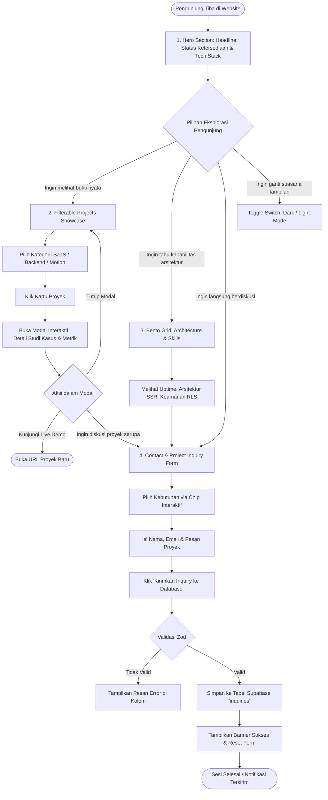
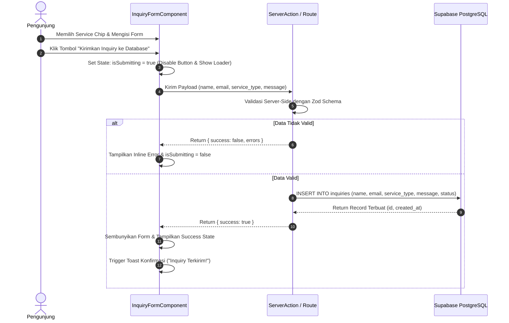
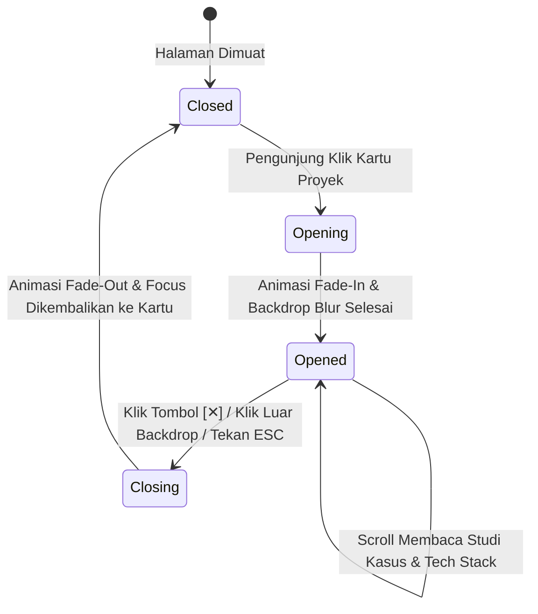
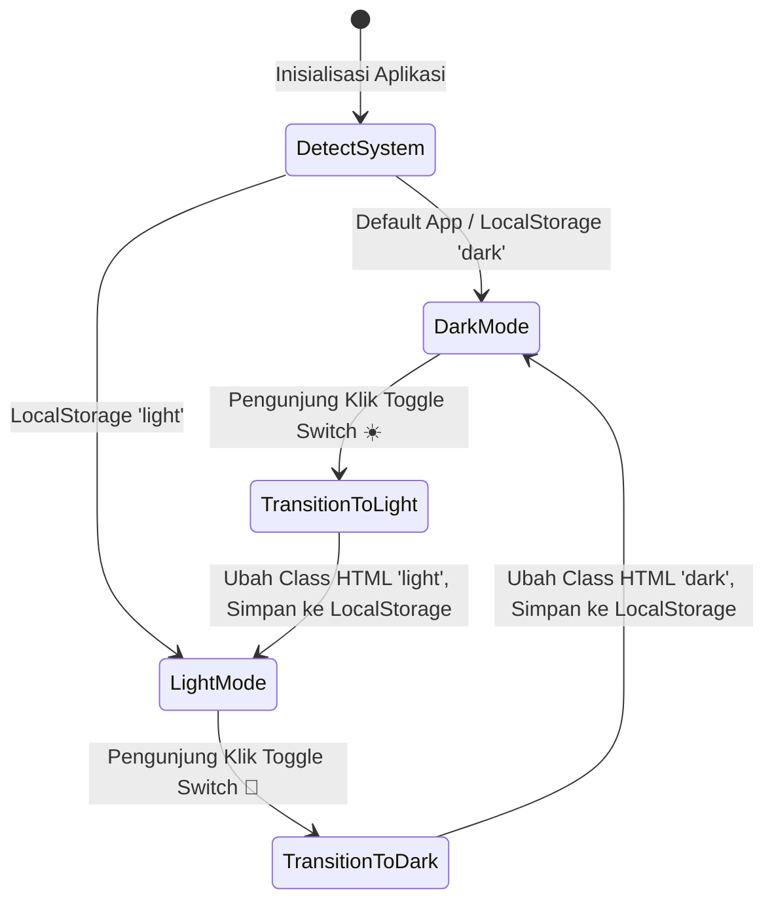

# App Flow Documentation (AFD)
## Professional Full-Stack Developer Portfolio (Eloqwnt-Grade)

---

### 1. High-Level User Journey Flow

Alur navigasi website dirancang agar minim hambatan (*frictionless*), memberikan impresi visual kuat dalam 5 detik pertama, dan mengarahkan pengunjung ke aksi konversi utama (*Contact / Hire / Case Study*).

---

### 2. Detailed User Journey Scenarios

#### Scenario A: The Tech Recruiter / Talent Scout (Speed & Tech Fit)
1. **Landing (0-5s)**: Melihat beacon hijau "Available for Projects", headline "Senior Full-Stack Software Engineer", dan logo ticker Next.js/Supabase/TypeScript.
2. **Scan (5-20s)**: Scroll ke bagian Bento Grid untuk melihat bukti kompetensi (SSR, Type-Safe API, Uptime 99.8%).
3. **Action (20-40s)**: Menekan tombol "Start Project" di header atau "Schedule Discovery Call" di hero section.
4. **Outcome**: Mengirimkan tawaran via form kontak terstruktur atau mengklik link LinkedIn di footer.

#### Scenario B: The Technical Lead / CTO (Code & Architecture Proof)
1. **Landing (0-10s)**: Menilai kualitas rancangan visual, performa fluid 60fps, dan kerapian tipografi.
2. **Filter & Deep-Dive (10-60s)**: Mengklik tab filter "Backend & Supabase" untuk menyaring proyek relevan.
3. **Inspect Case Study (60-120s)**: Membuka modal salah satu proyek (misal: *PayNexus Billing OS* atau *DocuMind Vector Search*), membaca tantangan skalabilitas, stack yang dipakai, dan dampak metrik.
4. **Verification**: Mengklik tautan repository GitHub atau Live Demo dari dalam modal.

#### Scenario C: The Startup Founder / Client (Value & Trust)
1. **Landing**: Terpukau oleh kualitas branding premium Eloqwnt-style yang memberikan kredibilitas instan.
2. **Explore Services**: Membaca 4 kartu bento mengenai alur kerja transparan (Discovery, Execution, Handoff).
3. **Inquiry**: Memilih chip layanan "Web Application / Full-Stack", mengisi deskripsi ide, dan mengirimkan pesan.

---

### 3. State Transitions & Interaction Flows

#### 3.1 Contact Form Submission Sequence

#### 3.2 Modal Case Study State Machine

#### 3.3 Theme Switch State Flow

---

### 4. Edge Cases & Error Handling Flow

| Skenario Hambatan | Mekanisme Penanganan UI/UX | Dampak ke Pengunjung |
| :--- | :--- | :--- |
| **Koneksi Jaringan Putus saat Kirim Pesan** | Form mendeteksi error network, menampilkan badge peringatan merah, data isian input tetap terjaga (tidak hilang). | Pengunjung cukup klik tombol coba lagi (*Retry*) tanpa mengetik ulang. |
| **Pengunjung Mengisi Email Tidak Valid** | Validasi Zod langsung mengidentifikasi sebelum request dikirimkan ke server. | Muncul teks bantuan "Format email tidak valid". |
| **Koneksi Supabase Lambat** | Tombol submit menampilkan spinner halus dengan batas timeout 8 detik. | Pengunjung mengetahui sistem sedang memproses dan mencegah klik ganda (*double submit*). |
| **Layar Sangat Kecil (< 360px)** | Grid bento secara otomatis beralih menjadi 1 kolom murni, font ukuran responsif, padding disesuaikan. | Tidak ada teks terpotong atau horizontal overflow yang merusak estetika. |
