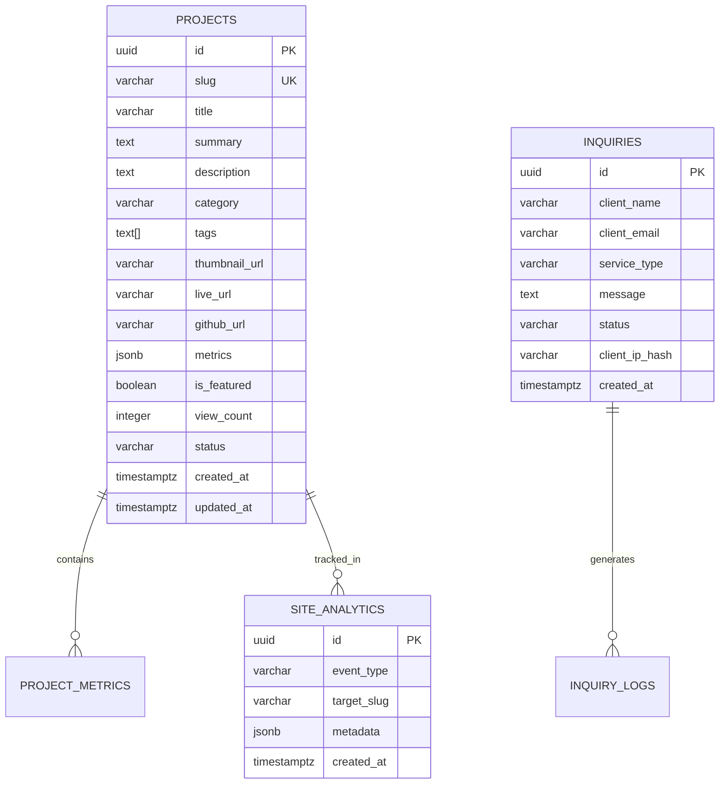

# Backend Schema Documentation (BSD)
## Professional Full-Stack Developer Portfolio (Eloqwnt-Grade)

---

### 1. Database Platform & Engine
- **Engine**: Supabase Managed PostgreSQL (v15+)
- **Extensions**:
  - `uuid-ossp` / `pgcrypto` (untuk pembuatan UUID otomatis)
  - `pg_trgm` (opsional untuk full-text fuzzy search pada proyek)
- **Security Paradigm**: Zero-trust dengan **Row-Level Security (RLS)** aktif di setiap tabel.

---

### 2. Entity Relationship (ER) Diagram



---

### 3. Detailed Table Specifications & SQL DDL

#### 3.1 Tabel `projects` (Katalog Studi Kasus & Proyek)
Menyimpan seluruh data proyek yang tampil pada showcase filterable.

```sql
-- Aktifkan ekstensi UUID
CREATE EXTENSION IF NOT EXISTS "uuid-ossp";

-- Buat ENUM untuk status dan kategori proyek
CREATE TYPE project_category AS ENUM ('fullstack', 'backend', 'creative', 'saas');
CREATE TYPE publication_status AS ENUM ('draft', 'published', 'archived');

CREATE TABLE public.projects (
    id UUID PRIMARY KEY DEFAULT uuid_generate_v4(),
    slug VARCHAR(120) UNIQUE NOT NULL,
    title VARCHAR(200) NOT NULL,
    summary TEXT NOT NULL,
    description TEXT NOT NULL,
    category project_category NOT NULL DEFAULT 'fullstack',
    tags TEXT[] NOT NULL DEFAULT '{}',
    thumbnail_url TEXT,
    live_url TEXT,
    github_url TEXT,
    metrics JSONB DEFAULT '{}'::jsonb,
    is_featured BOOLEAN NOT NULL DEFAULT false,
    view_count INTEGER NOT NULL DEFAULT 0,
    status publication_status NOT NULL DEFAULT 'published',
    order_index INTEGER NOT NULL DEFAULT 0,
    created_at TIMESTAMPTZ NOT NULL DEFAULT timezone('utc'::text, now()),
    updated_at TIMESTAMPTZ NOT NULL DEFAULT timezone('utc'::text, now())
);

-- Indexing untuk query cepat
CREATE INDEX idx_projects_status_featured ON public.projects(status, is_featured, order_index);
CREATE INDEX idx_projects_category ON public.projects(category);
CREATE INDEX idx_projects_slug ON public.projects(slug);
```

#### 3.2 Tabel `inquiries` (Pesan Masuk & Permintaan Proyek)
Menyimpan leads dari formulir kontak interaktif.

```sql
CREATE TYPE inquiry_status AS ENUM ('new', 'contacted', 'in_discussion', 'archived');

CREATE TABLE public.inquiries (
    id UUID PRIMARY KEY DEFAULT uuid_generate_v4(),
    client_name VARCHAR(150) NOT NULL,
    client_email VARCHAR(255) NOT NULL,
    service_type VARCHAR(100) NOT NULL,
    message TEXT NOT NULL,
    status inquiry_status NOT NULL DEFAULT 'new',
    client_ip_hash VARCHAR(64),
    created_at TIMESTAMPTZ NOT NULL DEFAULT timezone('utc'::text, now())
);

-- Indexing untuk dashboard manajemen leads
CREATE INDEX idx_inquiries_status ON public.inquiries(status, created_at DESC);
```

#### 3.3 Tabel `site_analytics` (Pencatatan Event Interaktif)
Mencatat statistik anonim seperti pembukaan modal dan durasi pembacaan studi kasus.

```sql
CREATE TABLE public.site_analytics (
    id UUID PRIMARY KEY DEFAULT uuid_generate_v4(),
    event_type VARCHAR(50) NOT NULL, -- 'page_view', 'case_study_open', 'resume_download'
    target_slug VARCHAR(120),
    metadata JSONB DEFAULT '{}'::jsonb,
    created_at TIMESTAMPTZ NOT NULL DEFAULT timezone('utc'::text, now())
);

CREATE INDEX idx_analytics_event ON public.site_analytics(event_type, created_at DESC);
```

---

### 4. Row-Level Security (RLS) Policies

Setiap tabel diisolasi dengan aturan otorisasi ketat:

```sql
-- 1. Enable RLS pada seluruh tabel
ALTER TABLE public.projects ENABLE ROW LEVEL SECURITY;
ALTER TABLE public.inquiries ENABLE ROW LEVEL SECURITY;
ALTER TABLE public.site_analytics ENABLE ROW LEVEL SECURITY;

-- 2. Policies untuk Tabel 'projects'
-- Publik hanya boleh membaca proyek yang berstatus 'published'
CREATE POLICY "Public can view published projects"
    ON public.projects FOR SELECT
    TO anon, authenticated
    USING (status = 'published');

-- Hanya service_role yang boleh INSERT/UPDATE/DELETE
CREATE POLICY "Admins have full access to projects"
    ON public.projects FOR ALL
    TO service_role
    USING (true)
    WITH CHECK (true);

-- 3. Policies untuk Tabel 'inquiries'
-- Pengunjung (anon) boleh memasukkan inquiry baru
CREATE POLICY "Public can insert project inquiries"
    ON public.inquiries FOR INSERT
    TO anon, authenticated
    WITH CHECK (
        length(client_name) >= 2 AND
        length(client_email) >= 5 AND
        length(message) >= 10
    );

-- Hanya service_role yang boleh membaca daftar inquiry
CREATE POLICY "Only admins can view inquiries"
    ON public.inquiries FOR SELECT
    TO service_role
    USING (true);

-- 4. Policies untuk Tabel 'site_analytics'
CREATE POLICY "Public can log analytics"
    ON public.site_analytics FOR INSERT
    TO anon, authenticated
    WITH CHECK (true);
```

---

### 5. Stored Procedures & Database Functions

#### 5.1 Increment View Counter (Atomic & Thread-Safe)
Menghindari race condition saat banyak pengunjung membuka studi kasus secara simultan.

```sql
CREATE OR REPLACE FUNCTION public.increment_project_views(p_slug VARCHAR)
RETURNS void
LANGUAGE plpgsql
SECURITY DEFINER
AS $$
BEGIN
    UPDATE public.projects
    SET view_count = view_count + 1
    WHERE slug = p_slug;
END;
$$;
```

#### 5.2 Trigger Auto Update `updated_at`
```sql
CREATE OR REPLACE FUNCTION public.handle_updated_at()
RETURNS TRIGGER AS $$
BEGIN
    NEW.updated_at = timezone('utc'::text, now());
    RETURN NEW;
END;
$$ LANGUAGE plpgsql;

CREATE TRIGGER trigger_update_projects_timestamp
    BEFORE UPDATE ON public.projects
    FOR EACH ROW
    EXECUTE FUNCTION public.handle_updated_at();
```

---

### 6. Initial Seed Data (Benchmark Proyek)

```sql
INSERT INTO public.projects (slug, title, summary, description, category, tags, metrics, is_featured, order_index)
VALUES 
(
    'paynexus-billing-os',
    'PayNexus - Enterprise Billing & Settlement Engine',
    'Sistem otomatisasi penagihan dan rekonsiliasi kas perbankan dengan pemrosesan ribuan transaksi per menit secara real-time.',
    'Membangun arsitektur multi-tenant dengan Row-Level Security (RLS) di Supabase, antrean background worker, dan dashboard analitik interaktif dengan latency < 150ms.',
    'fullstack',
    ARRAY['Next.js 14', 'Supabase RLS', 'PostgreSQL', 'Stripe', 'Redis'],
    '{"uptime": "99.98%", "volume": "Rp 85M+ Diselesaikan"}'::jsonb,
    true,
    1
),
(
    'documind-vector-search',
    'DocuMind - AI Knowledge Graph & Vector Search',
    'Platform retrieval-augmented generation (RAG) untuk pencarian dokumen hukum korporasi dengan pgvector dan similarity ranking.',
    'Implementasi embedding pipeline, chunking dokumen otomatis, dan query vector cosine similarity langsung di PostgreSQL untuk akurasi pencarian semantik tinggi.',
    'backend',
    ARRAY['Supabase pgvector', 'TypeScript', 'Next.js App Router', 'LangChain'],
    '{"latency": "< 180ms", "documents": "100k+ Lembar Terindeks"}'::jsonb,
    true,
    2
),
(
    'aura-kinetic-showcase',
    'Aura Motion - 3D Interactive Design Showcase',
    'Website portofolio kinetik interaktif dengan transisi WebGL dan micro-interactions berbasis Framer Motion.',
    'Eksperimen UI mutakhir yang menggabungkan shader WebGL responsif, transisi halaman instan, dan optimasi GPU tanpa lag pada mobile maupun desktop.',
    'creative',
    ARRAY['Framer Motion', 'Three.js', 'Tailwind CSS', 'WebGL'],
    '{"fps": "Solid 60fps", "awards": "Awwwards Nominee"}'::jsonb,
    true,
    3
);
```
